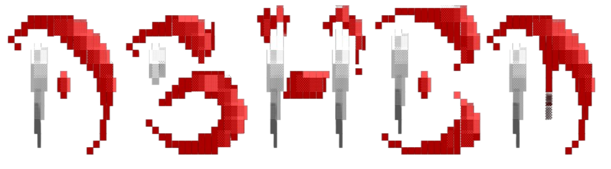

# 

[](https://git.io/typing-svg)


Ashen is a roguelike terminal game made in python.Explore dungeon,defeat monsters and find your way out

## Features

 - **Procedural Dungeons** - Explore randomly generated rooms
 - **Turn Based Combat** 
 - **Fog of War** - Hidden areas untill you explore them
 - **Wall Hack**
 - **Leaderboard**

 ## Controls

##  Controls

| Key | Action |
| :---: | :--- |
|     | **Movement** |
|  | Small HP Potion |
|  | Small Stamina Potion |
|  | Full Stamina Potion |
|  | View Leaderboard |
|   | Restart / Quit |

## Items

| Item | Key | Effect |
| :--- | :---: | :--- |
| **Small HP Potion** | <kbd>P</kbd> |  |
| **Small Stamina Potion** | <kbd>O</kbd> |  |
| **Full Stamina Potion** | <kbd>I</kbd> |  |

## Building from Source


### Requirements
- Python 3.12+
- Windows

### 1 . Clone the repo

```bash
git clone https://github.com/asura-cr/ashen.git
cd ashen
```
### 2. Install dependencies

```bash
pip install rich colorama
```

### 3. Launch
```bash
python main.py
```

## Installation

1. Go to [latest releases](https://github.com/asura-cr/releases/latest) and install the .exe
2. Open .exe
